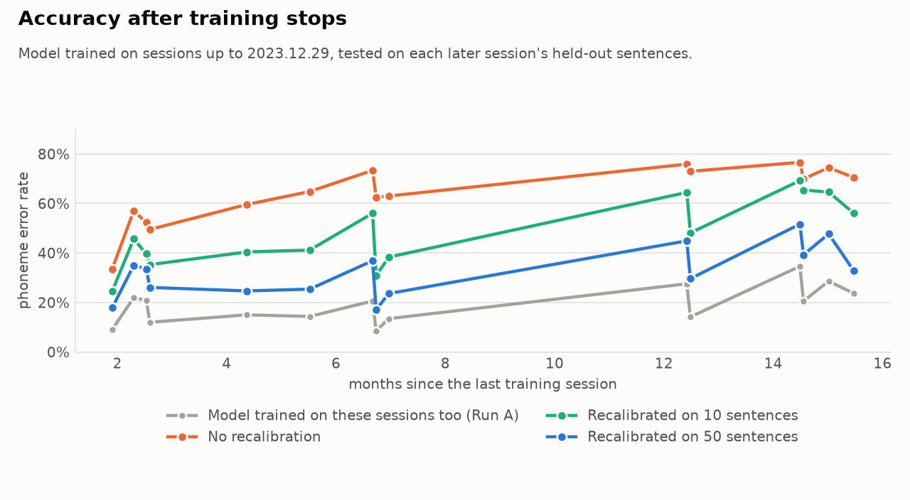
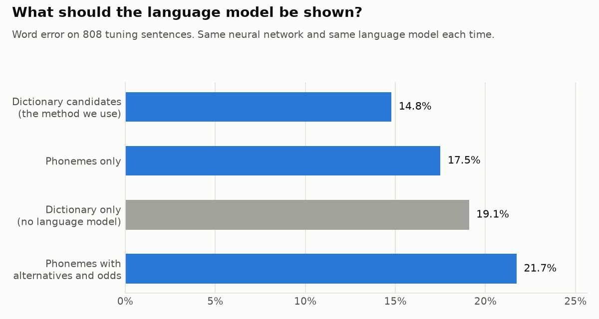
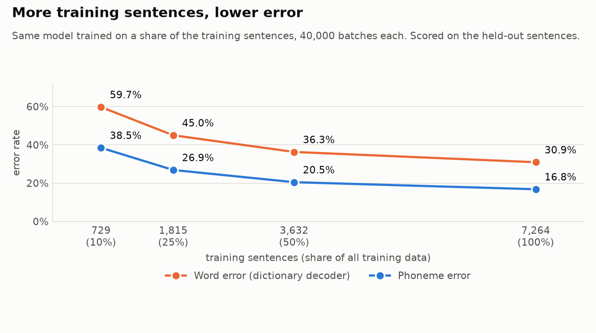
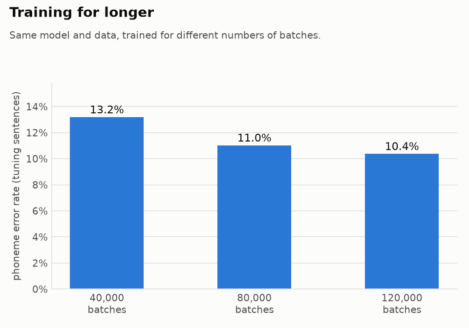
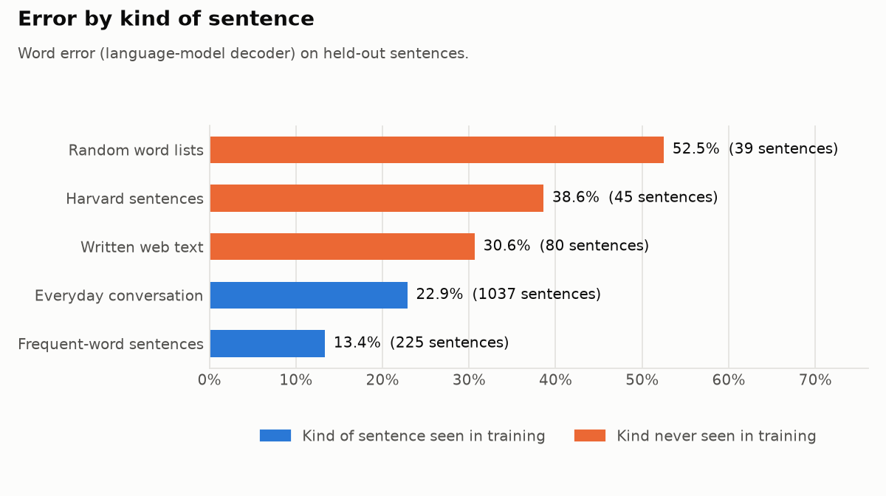

# NeuroScribe
**Track:** AI + Languages\
**Team:** Theodore Chen, Aden Hochberg, and Bradyn McLean

## The problem
Hundreds of thousands of people lose the ability to speak because of a loss of motor control of the jaw. Communication is essential for quality of life and for daily function, and losing the ability to speak is a life changing scenario that's difficult to navigate.

**Who it's for:** an adult with ALS (amyotrophic lateral sclerosis) or another motor dysfunction who can no longer speak clearly, at the moment they want to tell a family member or carer something. The input is neural activity recorded while they *attempt* to speak; the output is the sentence as text or voice.

## What we built
People who have *lost* the ability to speak have a strong advantage over those who have been unable to speak their whole lives - their brains still *know* how to speak, even if they can't make the actual noise. 

We built a model to interpret neural signals from someone's brain into intended speech, allowing English-speakers to effectively convert thought to text.

Using BCI (brain computer interfaces), it is possible to receive information about neural firings in specific parts of the brain. This data acts as the input for our model. Our model outputs predicted phonemes, which can then be converted into real English words and sentences.
> A phoneme is the smallest unit of spoken sound in a language. We are using the 39 phonemes of American English (the language our data is for), plus a silence marker between words and a "blank", for 41 classes in total.

We used Card et al.'s public dataset and approach, but trained our own model using our own code and device. We also used different data splits to best fit our approach. Our biggest difference from the Card et al. lab was the questions we chose to ask and how we decided to answer them.

## How it works
\
*Figure 1: Image from the lab's GitHub repository (see [Sources](#Sources))*

Neural firing information is processed into "bins" of 20ms, each bin measuring neural data for all neurons that were recorded (four implanted microelectrode arrays, each measuring 3.2mm by 3.2mm and containing 64 electrodes, each with a 50 micrometer recording site). Every 80ms, we used a 280ms window of past and future information to predict the sound the person was trying to make during those 80ms. Passing the information from the bins allows us to create a distribution graph over that 80ms time span of our predicted sound.

Those sounds are processed as phonemes, which we then converted into English text.

In more detail, the pipeline has these steps:
1. **Input.** Every 20ms, 512 numbers describing neural activity near 256 electrodes in the part of the brain that controls speech movements.
2. **Smoothing and windows.** The signal is smoothed and cut into overlapping 280ms windows, one every 80ms.
3. **Per-session layer.** Each recording day has its own small layer that re-maps that day's signals into a common form. This is the "personal" part of the model.
4. **Shared recurrent network (GRU).** Outputs a distribution of the probability that the person was trying to say each of the 41 sounds
5. **Reading out phonemes.** Take the top class per window, merge repeats and drop blanks.
6. **Phonemes to words.** We built two decoders: one looks up each word-chunk in the [CMU Pronouncing Dictionary](http://www.speech.cs.cmu.edu/cgi-bin/cmudict) by closest match, and the other gives a language model (Google Gemini 3.1 Flash Lite) each chunk plus the dictionary's five closest words and asks for the most likely sentence.

The model is trained with CTC loss, which lets it learn the phoneme sequence without being told exactly when each phoneme happened (see [CTCLossFunction.md](notes/CTCLossFunction.md)). The model design follows the dataset authors' baseline, but we wrote our own implementation.

The full process can be seen in Figure 1.

### Demo app
The `app/` folder holds a web demo: drop an HDF5 file of neural recordings onto the page and it shows the decoded phonemes, the dictionary decoder's words, the language-model sentence and the final sentence (read aloud), with the attempted sentence at the top when it is known. The language-model step is not run live (it needs a Gemini key and internet); for held-out val recordings the page shows the saved Gemini 3.1 sentence from `results/run_a_val_gemini31.json`. Run it with `python app/server.py`; see [app/README.md](app/README.md). The earlier version of the app is kept in `app_v2/`.

## Process
The data from the lab was collected across 45 sessions over the span of two years. We split this data into four parts, `train`, `tune`, `val`, and `test`:
| | Train | Tune | Val | Test
| --- | --- | --- | --- | ---
| Number of sentences | 7,264 | 808 | 1,426 | 1,450 |
| Does it contain the true sentence? | Yes | Yes | Yes | No |
| Where does it comes from? | Authors' training files | A random 10% of the authors' training files, per session | Authors' validation files | Authors' test files |
| What is it used for? | Teaching the model | Used during training to check progress and determine which iteration is the best and should be saved | Final measurement | Demo input only |

We kept the dataset's official train/val split (instead of re-splitting it ourselves) so our final score is directly comparable to the published one. We treated `tune` as the "practice test", used for every decision we made, and `val` as the "final exam", which was never used at all during the training process. Because of this, `val` scores are real results on unseen data.

A few other key decisions:
- **Predict phonemes, not words.** The recorded brain area controls speech *movements*, and 41 phoneme classes are far easier to learn than a whole vocabulary.
- **Skip the authors' n-gram language models.** They need about 60-300 GB of RAM, so we used the dictionary and Gemini decoders described above instead.
- **Keep everything participant-specific in one config file**, so the same code can be retrained on another person's data.

First, we trained a very basic and rudimentary linear model in about 6 minutes (5,000 batches of 64 sentences) to set a baseline for our prediction. Next, we trained a more advanced model (a GRU network), which took roughly 5.5 hours (running 120,000 total batches). This model used 5 recurrent layers of 768 units as opposed to the linear model's single layer, as well as using 44.3M parameters to the linear model's 294k. These upgrades were in addition to having a larger dataset to train on and training for longer. We did try to train the second model with 60,000 batches with a batch size of 64, but our machine ran out of memory, so we used 120,000 batches with a batch size of 32. (Sentences range from about 3 to 50 seconds, and a batch that happened to contain a very long sentence needed far more memory than our 11 GB GPU had. The authors trained on a 24 GB card.) 

After that, we wanted to test how the accuracy changes with the size of training data. When training each model with 40,000 batches, we trained four models with 10% (729 sentences), 25% (1,815), 50% (3,632) and 100% (7,264) of the training sentences.

This gave us two models trained on 100% of the training sentences at 40,000 batches and 120,000 batches respectively. Finally, we trained a model using 100% of the training sentences at 80,000 batches.

This allowed us to compare performance of models as the training duration changes.

We were then interested in exploring the concept of signal drift, which is essentially the brain's neural patterns changing over time. To explore this, we trained a model (40,000 batches) on only the first 27 sessions (Aug 11 to Dec 29, 2023; 4,629 training sentences). We then tested it on the val sentences from 15 of the 18 later sessions (508 sentences, 2 to 15.5 months after the last training day; the other 3 have no val sentences) and graphed how the accuracy of our model changed depending on the time since the last data the model trained on was collected. For each later session we also tried a quick "recalibration": retraining only that day's small per-session layer on 10 or 50 of its sentences, with the shared network locked.

Finally, we tested three different approaches on how to best utilise the language model. We ran three different tests, providing Gemini with three different things: a) phonemes plus the dictionary's candidate words (our method), b) phonemes only, and c) phonemes with the network's runner-up sounds and their probabilities. Along the way we found that switching from Gemini 3.5 Flash Lite to Gemini 3.1 Flash Lite lowered tune word error from 17.0% to 14.8% with the same method, so we switched (a choice made on tune only) and then scored val once with it.

All results from the models above are shown in [Results](#Results)

## Results
The PERs (phoneme error rates) in this first part are on the `tune` split. The example translations are one held-out `val` sentence, decoded with the dictionary decoder (no language model).

Our baseline linear model had a PER of 61.1%.

Here's an example of our model at work!\
Original, intended sentence: the jury and a judge work together on it\
Model translation: youths i i i i i aycock are i it

Our second model had a PER of 10.4%. After 4,000 batches, our model had a PER of 36.2%, 23.1% at 8,000, and 13.2% after 24,000 batches completed. It stopped improving much after about 56,000 batches (10.6%).

Here's an example of our model at work!\
Original, intended sentence: the jury and a judge work together on it\
Model translation: the jury and a just work together on it

Our four overnight models (40,000 batches each) trained on 10%, 25%, 50%, and 100% of the training sentences had PERs of 34.5%, 22.7%, 16.5%, and 13.2% respectively.

Here's an example of our models at work!\
10%: The participant's intended speech of "the jury and a judge work together on it" turned into "the tree in a judge would consider on it"\
25%: The participant's intended speech of "the jury and a judge work together on it" turned into "the tree and a change work other on it"\
50%: The participant's intended speech of "the jury and a judge work together on it" turned into "the jury and a judge work another on it"\
100%: The participant's intended speech of "the jury and a judge work together on it" turned into "the jury and a just work another on it"

Our trained model with 80,000 batches with all of the training sentences had a PER of 11.0%.

Here's an example of our model at work!\
Original, intended sentence: the jury and a judge work together on it\
Model translation: the jury an a just work another on it

So with all of the training data, 40,000, 80,000 and 120,000 batches gave tune PERs of 13.2%, 11.0% and 10.4%: most of the benefit of longer training is in by 80,000 batches.

Our drift model reached 10.5% tune PER on its own 27 sessions (the `tune` data split), but on the later sessions it did much worse:

| Condition (508 val sentences from 15 later sessions) | Phoneme error | Word error (dictionary) |
| --- | --- | --- |
| No recalibration | 63.3% | 90.0% |
| Recalibrated on 10 sentences | 46.3% | 71.0% |
| Recalibrated on 50 sentences | 31.4% | 52.1% |
| For reference: our final model, which trained on these sessions | 18.0% | 31.6% |

Without recalibration, error was 33.6% on the first later session (1.9 months after training), roughly 50-57% at 2.3-2.6 months, and 70-77% after a year.

The language-model comparison on tune (word error, same 808 sentences, Gemini 3.1 Flash Lite):

| What Gemini is shown | Word error | Sentences fully correct |
| --- | --- | --- |
| Nothing (dictionary decoder only) | 19.1% | 290 |
| **Phonemes plus dictionary candidates (our method)** | **14.8%** | **401** |
| Phonemes only | 17.5% | 385 |
| Phonemes with runner-up sounds and their odds | 21.7% | 324 |

### Results on unseen data
All of the numbers above (except the drift experiment and the example translations) are on the `tune` split. Here is how our final model (120,000 batches) and the baseline did on the 1,426 held-out `val` sentences, which the model never learned from and which were never used to make any decisions during training:

| | Linear baseline | Our final model |
| --- | --- | --- |
| Phoneme error rate (model alone) | 63.5% | **13.7%** |
| Word error rate, dictionary decoder | 97.0% | 25.4% |
| Word error rate, language-model decoder | 92.2% | **21.1%** |

The baseline's language-model score was measured with Gemini 3.5 Flash Lite; we did not have enough free requests left to re-score it with 3.1. With 3.5, our model's language-model score was 23.1%.

In other words, the baseline gets fewer than 1 word in 10 right, while our model gets about 4 in 5 right on sentences it has never seen. For reference, the dataset authors' baseline scores 10.1% phoneme error on this same val set; ours was trained with half the batch size on a smaller GPU. With the language model, 477 of the 1,426 sentences (33%) were decoded with every word exactly right (315 with the dictionary decoder alone).

The data-amount experiment showed the same pattern on val as on tune (each point about 4 points higher), with every doubling of data still helping:

We also broke the val results down by the kind of sentence:

| Kind of sentence | Seen in training? | Sentences | Phoneme error | Word error (dictionary) | Word error (language model) |
| --- | --- | --- | --- | --- | --- |
| Frequent-word sentences | Yes | 225 | 8.1% | 15.4% | 11.0% |
| Everyday conversation | Yes | 1,037 | 14.1% | 25.3% | 21.3% |
| Written web text | No | 80 | 17.8% | 33.5% | 27.5% |
| Harvard sentences | No | 45 | 17.0% | 38.9% | 30.6% |
| Random word lists | No | 39 | 21.6% | 53.0% | 52.5% |

## Analysis
All the models we trained significantly outperformed our baseline linear model, even after only a little bit of training, showing that very little extra work can drastically improve accuracy of a model.

However, there is a point when more training doesn't do that much. Going from 40,000 to 80,000 batches cut tune phoneme error by 2.2 points, but the next 40,000 batches cut it by only 0.6, and in our example sentence the 80k and 120k models differed by only a couple of words. In contrast, increasing the data size (number of training sentences used) *does* still significantly increase the quality of the model, as shown in the results above.

Our model is clearly not perfect. When testing on many different sentences, our 120k batch model with all training sentences still made many mistakes. For example, when the participant was trying to say "the past few wakes are a case in point," the model predicted that the participant said "the house you weeks are a cheese in point."

Some other things we learned from the results:
- **The model does worse on kinds of sentences it never trained on.** Written web text, Harvard sentences and random word lists only appear in val, and they score noticeably worse. This explains part of why val is harder than tune.
- **The language model helps, but not everywhere.** Compared with the dictionary decoder, it improved 366 sentences, made 48 worse and left 1,012 the same (total wrong words 2,399 -> 1,992). It cuts word error by 4 to 8 points on most kinds of sentence, but barely helps on random word lists (53.0% -> 52.5%) or very short sentences (1-3 words: 32.2% -> 29.7%), where there is little context to lean on. It can also "fix" a sentence into the wrong thing: "so do you like your new truck" (which the dictionary decoder got right) became "so do you like your new track."
- **Which language model matters, and more information isn't always better.** Swapping Gemini 3.5 Flash Lite for 3.1 Flash Lite, with nothing else changed, improved word error by about 2 points on both tune and val. Giving Gemini the network's uncertainty about each sound made it *worse* than using no language model at all: it changed words that were right, added extra words and dropped apostrophes.
- **The model goes stale.** Within about two and a half months of its last training day, a model goes from usable to getting roughly half its phonemes wrong. Recalibrating just the per-session layer on 50 sentences (a few minutes of attempted speech) recovers most, but not all, of the loss, and helps less the older the model is. A real user would need to recalibrate every month or two.
- **Repeated wording didn't help.** The 162 val sentences whose wording also appears in training scored worse (25.0% word error) than new wording (20.6%), so the model is not just memorising sentences.
- **Many mistakes are words that sound alike.** For example, "my computer is not working anymore" became "my company is not working anymore." Even with perfect phonemes, words like "to"/"too"/"two" cause some errors.
- **The data curve hasn't flattened.** Going from 10% to 25% of the data cut error by 11.8 points, 25% to 50% by 6.2 points, and 50% to 100% by 3.3 points. More recordings from this participant would probably still improve the model.

## Limitations
- **One participant only.** "Retrainable for anyone" is a design goal; we tested adapting to later days from the same person, not to a new person.
- **One run per experiment.** We trained each model and ran each language-model comparison once, so we cannot say how much of a small difference is chance.
- **It does not read thoughts.** It decodes *attempted* speech from a brain area that controls speech movements, and it requires surgically implanted electrodes.
- **Prompted sentences.** The participant was copying text shown to them, and free conversation may be harder.
- **Privacy.** The language-model decoder sends text derived from brain data to an outside service (Gemini). A real product would need a model that runs locally.
- This project is a prototype and is not medical advice.

## Potential impact
For someone who has lost the ability to speak due to ALS, a stroke or another condition, being able to communicate again with family and carers is life-changing. Our results show that a model built by a small team in a weekend, on a single consumer GPU, can turn attempted speech into text with roughly 4 out of 5 words correct on sentences it has never seen. Our data-amount experiment also suggests that a usable model doesn't need an enormous amount of data: with only a tenth of the training sentences (729), our model was still far better than the baseline trained on everything (34.5% vs 61.1% phoneme error). Because the participant-specific parts of our system are kept separate from the shared parts, we hope this approach can be adapted to new people with much less effort, bringing this kind of technology closer to the people who need it.

## What we'd do next
Each person has different neural patterns that affect our prediction of speech. If we had more time, we would want to tweak/update our system to make it easier to efficiently gather and train data for new individuals. This could help expand the total impact of this tool.

Additionally, we could expand on this by increasing integration and allowing this tool to be used with other tools. For example, TTS (text-to-speech) services could be integrated to actually convert intended speech directly into real speech. For example, we could analyze past clips of the user speaking in an attempt to recreate their voice for this tool, trying to add as much authenticity to this person's synthetic speech.

As always, our model can definitely be improved. Another possible course of action is to tweak numbers and get our hands on more extensive resources in order to train a more powerful and accurate model.

## Sources
"An accurate and rapidly calibrating speech neuroprosthesis" by Card et al. (2024)
- [Full paper on New England Journal of Medicine](https://www.nejm.org/doi/full/10.1056/NEJMoa2314132?referrer=https%3A%2F%2Fgithub.com%2F)
- [GitHub repository](https://github.com/Neuroprosthetics-Lab/nejm-brain-to-text)
- [Data available on Dryad](https://datadryad.org/dataset/doi:10.5061/dryad.dncjsxm85)
- [Kaggle competition](https://www.kaggle.com/competitions/brain-to-text-25/data)

[CMU Pronouncing Dictionary](http://www.speech.cs.cmu.edu/cgi-bin/cmudict) (via the `cmudict` Python package)
[Google Gemini API](https://aistudio.google.com) (`gemini-3.1-flash-lite` for our headline results; `gemini-3.5-flash-lite` for the baseline and earlier runs) for the language-model decoder

Libraries: PyTorch, NumPy, h5py, cmudict, google-genai, matplotlib

## AI tools used
- [Claude Code](https://claude.com/product/claude-code) (Claude Fable 5.2, Anthropic): project planning, explanations, and helping write the code in `b2t/`
