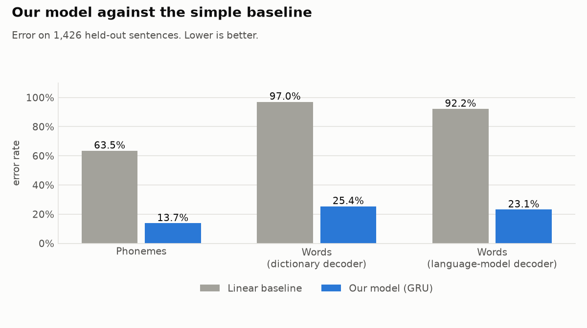

# Thought-to-Text
**Track:** AI + Languages\
**Team:** Theodore Chen, Aden Hochberg, and Bradyn McLean

## The problem
Many people have lost the ability to speak throughout their life. They've never lived without being able to speak, so they would be placed into a brand-new, life changing scenario that they probably don't know how to navigate.

These people have one strong characteristic over people who have been unable to speak their whole lives - they still *know* how to move their mouth to make the sounds to speak, even if they can't make the actual noise.

**Who it's for:** an adult with ALS who can no longer speak clearly, at the moment they want to tell a family member or carer something. The input is neural activity recorded while they *attempt* to speak; the output is the sentence as text.

## What we built
We built a model to interpret neural signals from someone's brain into intended speech, allowing English-speakers to effectively convert thought to text.

Using BCI (brain computer interfaces), it is possible to receive information about neural firings in specific parts of the brain. This data acts as the input for our model. Our model outputs predicted phonemes, which can then be converted into real English words and sentences.
> A phoneme is the smallest unit of spoken sound in a language. We are using a 41 phoneme set of sounds for American English, which is the language our data is for.

## How it works
\
*Figure 1: Image from the lab's GitHub repository (see [Sources](#Sources))*

Neural firing information is processed into "bins" of 20ms, each bin measuring neural data for all neurons that were recorded (four implanted microelectrode arrays, each measuring 3.2mm by 3.2mm and containing 64 electrodes, each with a 50 micrometer recording site). Every 80ms, we used a 280ms window of past and future information to predict the sound the person was trying to make during those 80ms. Passing the information from the bins allows us to create a distribution graph over that 80ms time span of our predicted sound.

Those sounds are processed as phonemes, which we then converted into English text.

In more detail, the pipeline has these steps:
1. **Input.** Every 20ms, 512 numbers describing neural activity near 256 electrodes in the part of the brain that controls speech movements.
2. **Smoothing and windows.** The signal is smoothed and cut into overlapping 280ms windows, one every 80ms.
3. **Per-session layer.** Each recording day has its own small layer that re-maps that day's signals into a common form. This is the "personal" part of the model.
4. **Shared recurrent network (GRU).** Carries a memory through the sentence and outputs, for each window, a score for each of 41 classes (39 phonemes, a silence marker between words, and a "blank").
5. **Reading out phonemes.** Take the top class per window, merge repeats and drop blanks.
6. **Phonemes to words.** We built two decoders: one looks up each word-chunk in the [CMU Pronouncing Dictionary](http://www.speech.cs.cmu.edu/cgi-bin/cmudict) by closest match, and the other gives a language model (Google Gemini) each chunk plus the dictionary's five closest words and asks for the most likely sentence.

The model is trained with CTC loss, which lets it learn the phoneme sequence without being told exactly when each phoneme happened (see [CTCLossFunction.md](notes/CTCLossFunction.md)). The model design follows the dataset authors' baseline, but we wrote our own implementation.

The full process can be seen in Figure 1.

## Process
The data from the lab was collected across 45 sessions over the span of two years. We split this data into four parts, `train`, `tune`, `val`, and `test`:
| | Train | Tune | Val | Test
| --- | --- | --- | --- | ---
| Number of sentences | 7,264 | 808 | 1,426 | 1,450 |
| Does it contain the true sentence? | Yes | Yes | Yes | No |
| Where does it comes from? | Authors' training files | A random 10% of the authors' training files, per session | Authors' validation files | Authors' test files |
| What is it used for? | Teaching the model | Used during training to check progress and determine which iteration is the best and should be saved | Final measurement | Demo input only |

We kept the dataset's official train/val split (instead of re-splitting it ourselves) so our final score is directly comparable to the published one. We treated `tune` as the "practice test", used for every decision we made, and `val` as the "final exam", which was never used to choose anything. Because of this, `val` scores are our honest results on unseen data.

A few other key decisions:
- **Predict phonemes, not words.** The recorded brain area controls speech *movements*, and 41 phoneme classes are far easier to learn than a whole vocabulary.
- **Skip the authors' n-gram language models.** They need about 60-300 GB of RAM, so we used the dictionary and Gemini decoders described above instead.
- **Keep everything participant-specific in one config file**, so the same code can be retrained on another person's data.

First, we trained a very basic and rudimentary linear model in about 20 minutes (5,000 batches) to set a baseline for our prediction. Next, we trained a more advanced model with more data, which took about 5.5 hours (running 120,000 total batches). This model used 5 layers as opposed to the linear model's 1 layer, as well as using 44.4M parameters to the linear model's 293k. These upgrades were in addition to having a larger dataset to train on and training for longer. We did try to train the second model with 60,000 batches with a batch size of 64, but our machine ran out of memory, so we used 120,000 batches with a batch size of 32. (Sentences range from about 3 to 50 seconds, and a batch that happened to contain a very long sentence needed far more memory than our 11 GB GPU had. The authors trained on a 24 GB card.) Halving the batch size while doubling the number of batches meant the model still saw the same total number of sentences.

We also hit a problem with the Gemini decoder: it returned nothing on realistic batches of 20 garbled sentences, because the model's "thinking" used up its whole output allowance before it wrote an answer. Lowering the thinking level, raising the output limit and cutting batches to 10 sentences fixed it.

After that, we wanted to test how the accuracy changes with the size of training data. On less time (40,000 batches), we trained four models with 10% of the training sentence data, 25% of the training sentence data, 50% of the training sentence data, and 100% of the training sentence data. This training ran overnight.

That gave us two models trained on 100% of the training sentences at 40,000 batches and 120,000 batches respectively. The clear next step for us was to train a model using 100% of the training sentences at 80,000 batches.

We were then prompted to explore the concept of signal drift, which is essentially the brain's neural patterns changing over time. To explore this, we trained a model on the first 27 training sessions. We then tested it on the sentences from the latter 18 sessions of the study and graphed how the accuracy of our model changed depending on the time since the last data the model trained on was collected.

All results from the models above are shown in [Results](#Results)

## Results
Our baseline linear model had a PER (phoneme error rate) of about 61%.

Here's an example of our model at work!\
Original, intended sentence: the jury and a judge work together on it\
Model translation: youths i i i i i aycock are i it\

Our second model had a PER of about 10.4%. After 4,000 batches, our model had a PER of 36.2%, 23.1% at 8,000, and 13.2% after 24,000 batches completed.

Here's an example of our model at work!\
Original, intended sentence: the jury and a judge work together on it\
Model translation: the jury and a just work together on it\

Our four overnight models (40,000 batches each) trained on 10%, 25%, 50%, and 100% of the training sentences had PERs of 34.5%, 22.7%, 16.5%, and 13.2% respectively.

Here's an example of our models at work!\
10%: The participant's intended speech of "the jury and a judge work together on it" turned into "the tree in a judge would consider on it"\
25%: The participant's intended speech of "the jury and a judge work together on it" turned into "the tree and a change work other on it"\
50%: The participant's intended speech of "the jury and a judge work together on it" turned into "the jury and a judge work another on it"\
100%: The participant's intended speech of "the jury and a judge work together on it" turned into "the jury and a just work on it"\

Our trained model with 80,000 batches with all of the training sentences had a PER of 11%.

Here's an example of our model at work!\
Original, intended sentence: the jury and a judge work together on it\
Model translation: the jury and a just work together on it\

Our drift measurement model produced the graph shown below.

### Results on unseen data
All of the numbers above are on the `tune` split. Here is how our final model (120,000 batches) and the baseline did on the 1,426 held-out `val` sentences, which the model never learned from and which were never used to make any decisions:

| | Linear baseline | Our final model |
| --- | --- | --- |
| Phoneme error rate (model alone) | 63.5% | **13.7%** |
| Word error rate, dictionary decoder | 97.0% | 25.4% |
| Word error rate, language-model decoder | 92.2% | **23.1%** |

In other words, the baseline gets about 1 word in 10 right, while our model gets about 3 in 4 right on sentences it has never seen. For reference, the dataset authors' baseline scores 10.1% phoneme error on this same val set; ours was trained with half the batch size on a smaller GPU. With the language model, 406 of the 1,426 sentences (28%) were decoded with every word exactly right.

The data-amount experiment showed the same pattern on val as on tune (each point about 4 points higher), with every doubling of data still helping:

We also broke the val results down by the kind of sentence:

| Kind of sentence | Seen in training? | Phoneme error | Word error |
| --- | --- | --- | --- |
| Frequent-word sentences | Yes | 8.1% | 13.4% |
| Everyday conversation | Yes | 14.1% | 22.9% |
| Written web text | No | 17.8% | 30.6% |
| Harvard sentences | No | 17.0% | 38.6% |
| Random word lists | No | 21.6% | 52.5% |

## Analysis
All the models we trained significantly outperformed our baseline linear model, even after only a little bit of training, showing that very little extra work can drastically improve accuracy of a model.

However, there is a point when more training data doesn't do that much. For the specific (and random) sample prompt used, the 40k, 80k, and 120k batch models showed the same result. This could show that increasing the number of batches might not be that influential on the quality of the model. Despite this, increasing the data size (number of training sentences used) *does* significantly increase the quality of the model, as shown in the results above.

Our model is clearly not perfect. When testing on many different sentences, our 120k batch model with all training sentences still made many mistakes. For example, when the participant was trying to say "the past few wakes are a case in point," the model predicted that the participant said "the house you weeks are a cheese in point."

Some other things we learned from the results:
- **The model does worse on kinds of sentences it never trained on.** Written web text, Harvard sentences and random word lists only appear in val, and they score noticeably worse. This explains part of why val is harder than tune.
- **The language model helps, but only a little.** Compared with the dictionary decoder, it improved 263 sentences, made 71 worse and left 1,092 the same. It barely helps on random word lists or very short sentences (1-3 words), where there is no context to lean on. It can also "fix" a sentence into the wrong thing: "can we use this for something" (which the dictionary decoder got right) became "we can use this for something."
- **Many mistakes are words that sound alike.** For example, "my computer is not working anymore" became "my company is not working anymore." Even with perfect phonemes, words like "to"/"too"/"two" cause some errors.
- **The data curve hasn't flattened.** Going from 10% to 25% of the data cut error by 11.8 points, 25% to 50% by 6.2 points, and 50% to 100% by 3.3 points. More recordings from this participant would probably still improve the model.

## Limitations
- **One participant only.** "Retrainable for anyone" is a design goal; we have not tested it on a new person.
- **It does not read thoughts.** It decodes *attempted* speech from a brain area that controls speech movements, and it requires surgically implanted electrodes.
- **Prompted sentences.** The participant was copying text shown to them, and free conversation may be harder.
- **Privacy.** The language-model decoder sends text derived from brain data to an outside service (Gemini). A real product would need a model that runs locally.
- This project is a prototype and is not medical advice.

## Potential impact
For someone who has lost the ability to speak due to ALS, a stroke or another condition, being able to communicate again with family and carers is life-changing. Our results show that a model built by a small team in a weekend, on a single consumer GPU, can turn attempted speech into text with roughly 3 out of 4 words correct on sentences it has never seen. Our data-amount experiment also suggests that a usable model doesn't need an enormous amount of data: with only a tenth of the training sentences (729), our model was still far better than the baseline trained on everything (34.5% vs 61.1% phoneme error). Because the participant-specific parts of our system are kept separate from the shared parts, we hope this approach can be adapted to new people with much less effort, bringing this kind of technology closer to the people who need it.

## What we'd do next
Each person has different neural patterns that affect our prediction of speech. If we had more time, we would want to tweak/update our system to make it easier to efficiently gather and train data for new individuals. This could help expand the total impact of this tool.

Additionally, we could expand on this by increasing integration and allowing this tool to be used with other tools. For example, TTS (text-to-speech) services could be integrated to actually convert intended speech directly into real speech. For example, we could analyze past clips of the user speaking in an attempt to recreate their voice for this tool, trying to add as much authenticity to this person's synthetic speech.

As always, our model can definitely be improved. Another possible course of action is to tweak numbers and get our hands on more extensive resources in order to train a more powerful and accurate model.

## Sources
"An accurate and rapidly calibrating speech neuroprosthesis" by Card et al. (2024)
- [Full paper on New England Journal of Medicine](https://www.nejm.org/doi/full/10.1056/NEJMoa2314132?referrer=https%3A%2F%2Fgithub.com%2F)
- [GitHub repository](https://github.com/Neuroprosthetics-Lab/nejm-brain-to-text)
- [Data available on Dryad](https://datadryad.org/dataset/doi:10.5061/dryad.dncjsxm85)
- [Kaggle competition](https://www.kaggle.com/competitions/brain-to-text-25/data)
- [CMU Pronouncing Dictionary](http://www.speech.cs.cmu.edu/cgi-bin/cmudict) (via the `cmudict` Python package)
- [Google Gemini API](https://aistudio.google.com) (`gemini-3.5-flash-lite`) for the language-model decoder
- Libraries: PyTorch, NumPy, h5py, cmudict, google-genai

## AI tools used
- Claude Code (Anthropic): project planning, explanations, and helping write the code in `b2t/`
