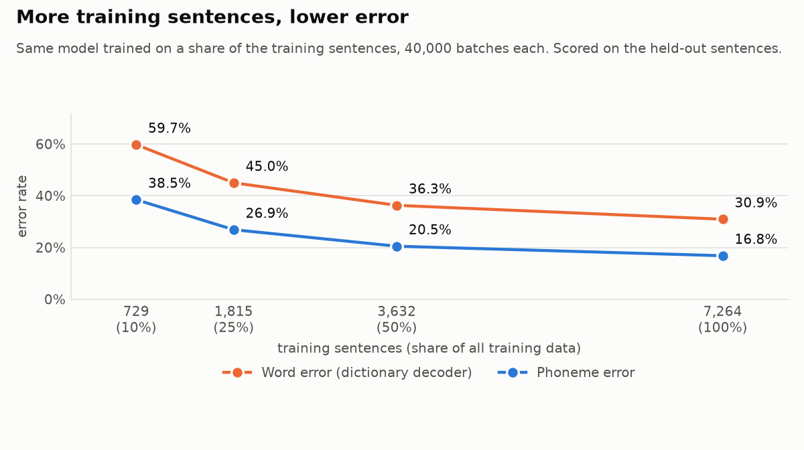
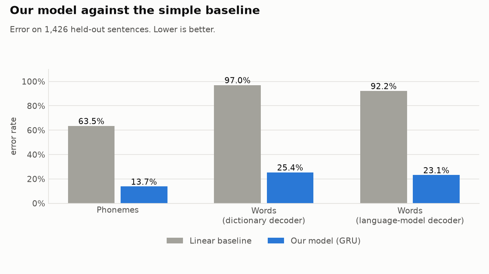
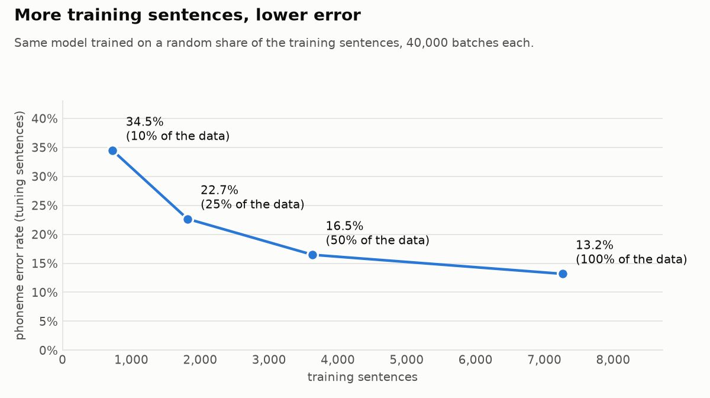
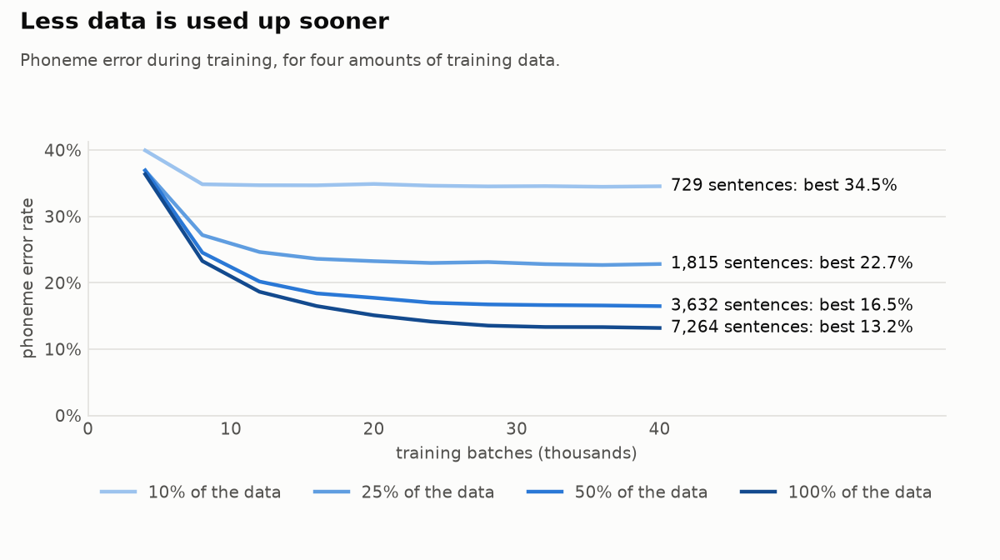
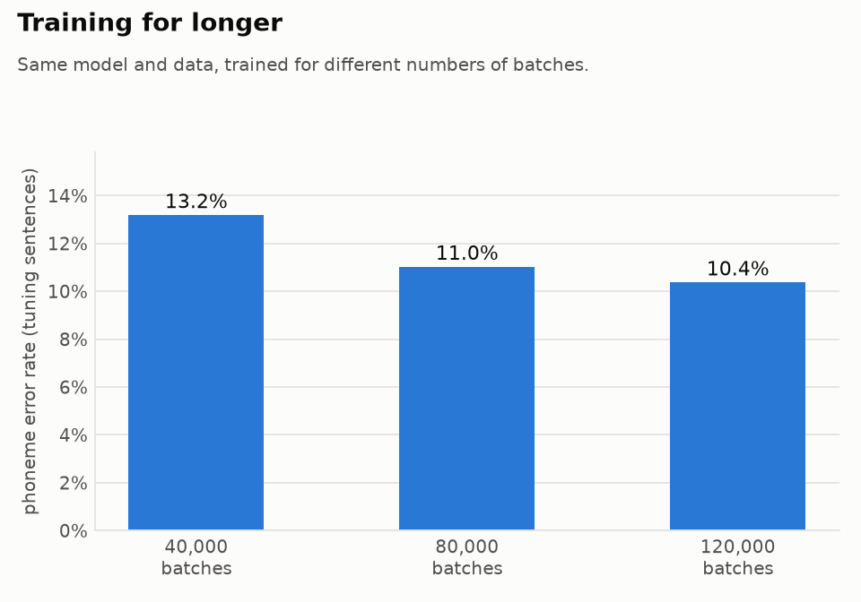
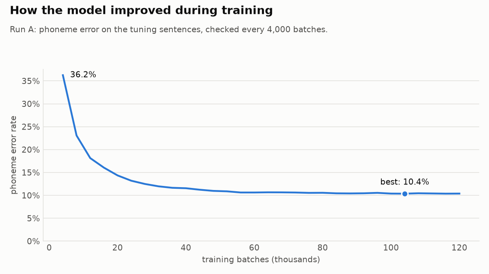
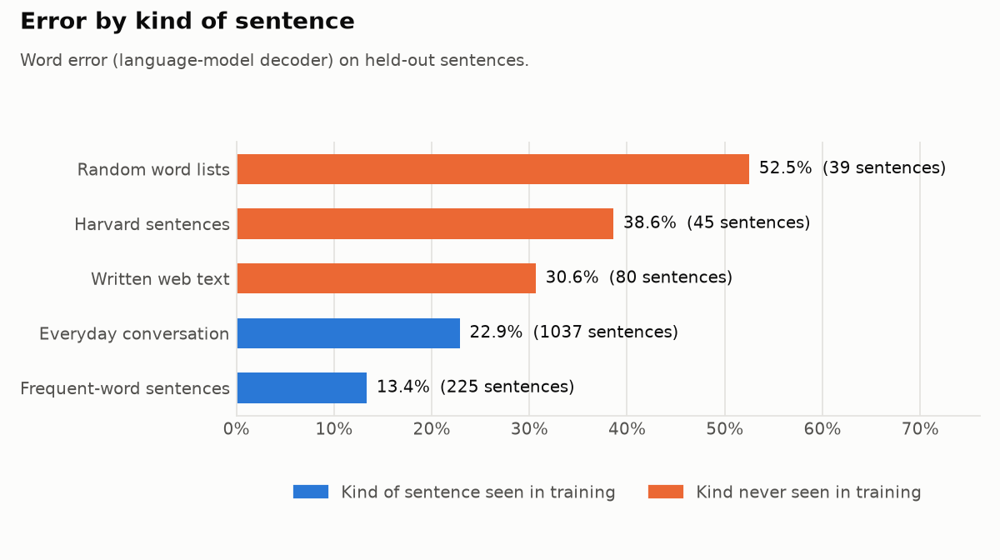
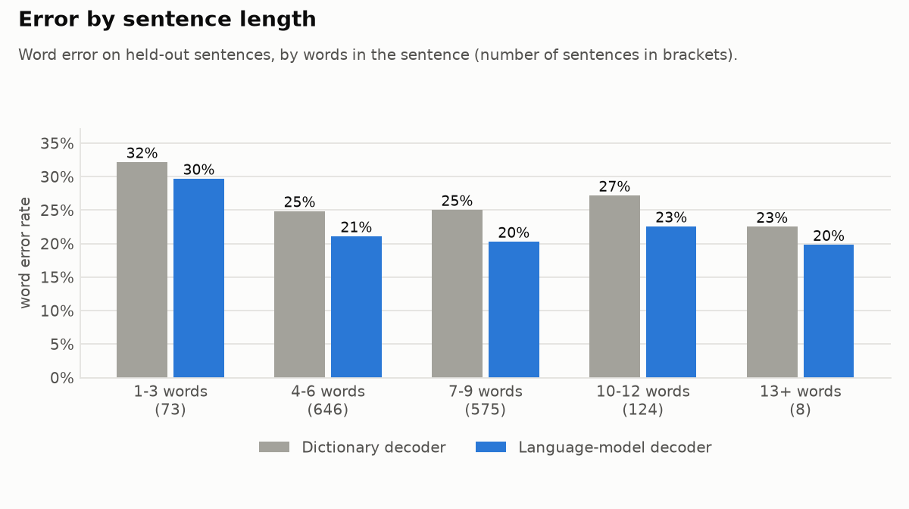
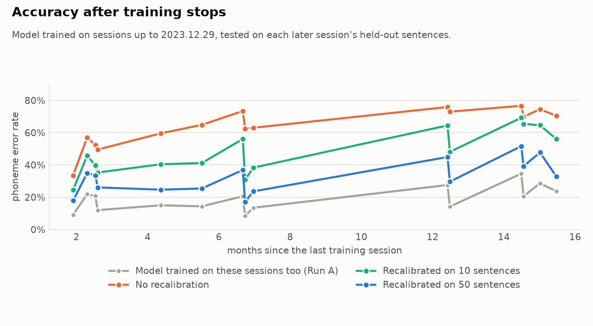

# Lab notebook

A running record of what we did, what we measured and what we decided. Newest entries
go at the bottom. This feeds the write-up (results, what didn't work, sources).

## Saturday, November 14

### Project decision
- Goal: decode attempted speech from neural recordings into English text, for people
  with motor speech disabilities.
- Track: **AI + Languages** (decided Sat night). The challenge is to help people
  "be understood", which is what the project is for, and its required evidence
  (model output beside the correct output, results broken down by group) is what
  our evaluation already produces. AI + Health asks for missed cases and false
  alarms and for equal performance across groups, which do not fit a
  one-participant sentence decoder. We still include the "not medical advice" line.
- User (provisional, Sat night; we may reword it): an adult with ALS who can no
  longer speak clearly, at the moment they want to tell a family member or carer
  something. Input: neural activity recorded while they attempt to speak. Output:
  the sentence as text.

### Data
- Brain-to-Text '25 dataset, participant T15, 45 recording sessions (Aug 2023 to Apr 2025).
- Each trial: neural features of shape (time, 512), one row per 20 ms, plus the phoneme
  sequence and sentence the participant was attempting to say.
- No cleaning was needed; features arrive already normalised.

### Splits (frozen in `splits/t15.json`)
| Split | Trials | Role |
|---|---|---|
| train | 7,264 | model learns from these |
| tune | 808 | early stopping and choosing settings (random 10% of each session's official train trials, seed 0) |
| val | 1,426 | final held-out test. Scored once so far: Run A, Sat night (see below) |
| test | 1,450 | no labels; demo inputs only |

- The training script loads only train and tune.
- 162 of the 1,426 val sentences have the same wording as a training sentence
  (different recordings). To be reported separately.
- Six 2025 sessions were set aside for a calibration experiment we later dropped
  (see "Change of plan"). They have 173 val trials between them.

### Results so far
| Run | Model | Sessions | Batches | Tune phoneme error rate | Notes |
|---|---|---|---|---|---|
| linear | one linear layer + CTC, 293,929 parameters | all 45 | 5,000 | 61.1% | simple baseline; 14.1 batches/s |
| run_a | GRU, 5 layers x 768 units, 44.3M parameters | all 45 | 120,000 at batch size 32 | **10.4%** | first attempt (60,000 at batch size 64, 3.4-3.5 batches/s) ran out of memory; see below |
| run_b | same GRU | 39 (2025 held out) | stopped partway | none | dropped Sat 11 PM, see "Change of plan" |
| run_a_long | same GRU | all 45 | never run | none | dropped Sat 11 PM, see "Change of plan" |

Run A progress on tune (batch size 32): 36.2% at batch 4,000, 23.1% at 8,000,
13.2% at 24,000. About 6.0 batches/s. These are tune scores taken during training,
so the final figure will be the best of them, not necessarily the last.

### Dictionary decoder, tested on damaged true phonemes (Sat afternoon)
Not a model result: we took the true phonemes of 300 tune sentences, added random
errors on purpose, and decoded with the CMU dictionary (`python -m b2t.decode_check`).

| Phoneme errors added | Actual phoneme error rate | Word error rate |
|---|---|---|
| 0% | 0.0% | 1.7% |
| 5% | 5.1% | 12.4% |
| 10% | 9.2% | 19.9% |
| 20% | 19.5% | 38.6% |

- Word error is roughly double the phoneme error: one wrong phoneme can ruin a whole word.
- Even perfect phonemes give 1.7% word error, from words that sound the same
  ("to"/"too"/"two"). All 1,899 words in these sentences are in the dictionary.
- Typical failure: an exact match to a rare word beats a near match to a common one
  ("D OW" became "dau" when the truth was "know"). The decoder has no sense of which
  words are likely. This is the motivation for adding a language model.
- Random damage is not how a real model errs, so these numbers are a guide only.

### Linear baseline, end to end (Sat evening)
`python -m b2t.evaluate --run runs/linear --split tune --limit 20 --llm`, on a random
20 tune sentences. A very small sample, so these are rough.

| Stage | Error rate |
|---|---|
| Phoneme error rate (model alone) | 63.8% |
| Word error rate, dictionary decoder | 91.6% |
| Word error rate, language-model decoder (Gemini) | 84.0% |

- With about 6 in 10 phonemes wrong, almost no words survive: the decoders cannot
  rescue a model this weak. The language model helped a little (91.6% -> 84.0%).
- That 20-sentence run used Gemini 4 Hydrogen, whose free tier allows only 20
  requests a day. We switched to Gemini 3.5 Flash Lite (500 a day) for everything after.

**Full baseline result, all 808 tune sentences** (Gemini 3.5 Flash Lite, Sat evening).
This is the baseline row to compare Run A against.

| Stage | Error rate |
|---|---|
| Phoneme error rate (model alone) | 61.1% |
| Word error rate, dictionary decoder | 95.2% |
| Word error rate, language-model decoder | 89.7% (0 sentences fell back) |

### Run A, end to end (Sat night)
`python -m b2t.evaluate --run runs/run_a --split tune --llm --llm-model gemini-3.5-flash-lite`,
all 808 tune sentences, the same sentences as the baseline.

| Stage | Linear baseline | Run A (GRU) |
|---|---|---|
| Phoneme error rate (model alone) | 61.1% | 10.4% |
| Word error rate, dictionary decoder | 95.2% | 19.1% |
| Word error rate, language-model decoder | 89.7% | 17.0% (0 sentences fell back) |

- The baseline gets about 1 word in 10 right; Run A gets about 5 in 6 right.
- The dictionary result matches what the damaged-phoneme test suggested for about
  10% phoneme error (roughly 20%).
- The language model helps, but only by about 2 points (19.1% -> 17.0%). TODO: look
  at the saved predictions to see which errors it fixes and which it cannot.
- These are tune scores. Val will probably be somewhat worse.

**Run A on val, the held-out test set (Sat night).** Same command with `--split val`,
all 1,426 val sentences.

| Stage | Run A on tune | Run A on val |
|---|---|---|
| Phoneme error rate (model alone) | 10.4% | 13.7% |
| Word error rate, dictionary decoder | 19.1% | 25.4% |
| Word error rate, language-model decoder | 17.0% | 23.1% (0 sentences fell back) |

- Val is the honest number. The model never learned from val, never used it to
  choose anything, and val comes from different recording blocks than training.
- Why tune looks better: the model did not learn from tune either, but tune was used
  to pick the best weights during training, and tune trials come from the same
  recording blocks as training trials. So tune is a slightly easier, slightly
  flattering test. It is still fine for comparing our own models with each other.
- Like-for-like with the dataset authors: their baseline scores 10.1% phoneme error
  on this same val set; Run A scores 13.7%. We trained for half as many sentences
  per batch on a smaller GPU.
**Linear baseline on val (Sat night),** all 1,426 val sentences, for a
baseline-vs-model comparison on the same unseen data.

| Stage | Linear baseline on val | Run A on val |
|---|---|---|
| Phoneme error rate (model alone) | 63.5% | 13.7% |
| Word error rate, dictionary decoder | 97.0% | 25.4% |
| Word error rate, language-model decoder | 92.2% | 23.1% |

TODO: confirm the baseline run's last line said "0 sentences fell back".

- **Disclosure for the write-up:** val has now been scored once, for Run A. We did
  not change anything in response. From here on, every choice (which model to keep,
  any decoder changes) is made on tune only. Val is scored again only for the final
  chosen model, and we report every val score we ever computed.

Reference point: the dataset authors report 10.1% phoneme error rate on val for their
baseline, trained for 120,000 batches.

### Decisions and why
- Kept the dataset's official train/val split instead of re-splitting 80/20, so our
  final score is comparable with the published one.
- Predict phonemes, not words: the recorded brain area controls speech movements,
  and 41 phoneme classes are far easier to learn than a whole vocabulary.
- Model design follows the dataset authors' baseline (per-session input layer + GRU +
  CTC loss). We wrote our own implementation.
    > For more information on CTC loss, see CTCLossFunction.md
- Everything specific to the participant is in `configs/t15.toml`, so the same code
  can be retrained on another person's data.
- Skipped the authors' n-gram language models: they need about 60 GB to 300 GB of RAM.

### What didn't work / problems hit
- **Out of memory with the reference batch size (Sat, about 2 PM).**
  - What we tried: Run A with batches of 64 sentences, the dataset authors' setting.
  - What happened: it crashed between batches 1,500 and 1,600 with
    `torch.OutOfMemoryError`: "Tried to allocate 1.93 GiB. GPU 0 has a total capacity
    of 10.54 GiB of which 638.69 MiB is free."
  - Why we think it happened: sentences range from about 3 to about 50 seconds, and
    each batch is padded to its longest sentence. A batch that happens to include a
    very long sentence needs far more memory than a typical one. A short speed test
    (a few hundred batches) never drew such a batch, so it did not show the problem.
    The authors trained on a 24 GB card; ours has 11 GB.
  - What we changed: batch size 64 -> 32 and batches 60,000 -> 120,000, so the model
    still sees the same total number of sentences. We also set
    `PYTORCH_CUDA_ALLOC_CONF=expandable_segments:True` to reduce memory fragmentation.
  - Open question: the learning rate was tuned for batches of 64. We have not
    measured whether batches of 32 change the final score.
  - Lesson: a short test run only proves the typical case works. Rare inputs (here,
    the longest sentences) need checking too.
- **Gemini decoder returned nothing on real batches (Sat evening).**
  - What we tried: sending 20 sentences per request to Gemini (`gemini-4-hydrogen`,
    free tier) with the linear baseline's predicted phonemes and the dictionary's
    candidate words, asking for JSON back.
  - What happened, in order:
    1. `request failed (JSONDecodeError: Expecting value: line 1 column 1 (char 0))`.
       The reply was not valid JSON, but the error did not show what the reply was.
    2. We added a small connection test (`python -m b2t.llm_decode`). Its first
       version failed with "Cannot send a request, as the client has been closed".
       That was a bug in the test itself: the Gemini client was created and used in
       one line without being stored, so Python closed it before the request went out.
    3. With the test fixed, a two-sentence request worked (status "completed",
       both sentences decoded correctly). So the key, model name and format were fine.
    4. The real 20-sentence batch then failed with
       `the model returned no text (status='incomplete', errors=None)`.
  - Why we think it happened: the model "thinks" before answering and that thinking
    uses up its output allowance. A long batch of badly garbled phonemes used the
    whole allowance before any answer was written. Small requests finished; large
    ones did not. (Inferred from the status; we did not inspect token usage.)
  - What we changed: asked for the "low" thinking level, raised the output allowance
    to 16,000 tokens, and cut batches from 20 to 10 sentences. After that, 20
    sentences decoded with 0 falling back to the dictionary.
  - Open question: "low" thinking may cost some accuracy. Comparing "low" with
    "medium" on the same sentences would be a cheap experiment.
  - Lessons: make error messages show what actually came back; test with realistic
    input sizes, not just a tiny example.
- TODO, add more as they happen.

### How the whole system works, in plain words
For the write-up's "How it works" section and for explaining to judges.

1. **Input.** One sentence's recording: every 20 ms, 512 numbers describing neural
   activity near 256 electrodes in the part of the brain that controls speech movements.
2. **Smoothing and windows.** The signal is smoothed over time and cut into
   overlapping 280 ms windows, one every 80 ms. (`b2t/models.py`, `Frontend`)
3. **Per-session layer.** Each recording day has its own small layer that re-maps
   that day's signals into a common form. This is the personal part. (`SessionLayers`)
4. **Shared recurrent network (GRU).** Carries a memory through the sentence and
   outputs, for each window, a score for each of 41 classes: 39 phonemes, a silence
   marker between words, and "blank" (nothing new). (`GRUDecoder`)
5. **Reading out phonemes.** Take the top class per window, merge repeats, drop
   blanks. (`greedy_decode` in `b2t/train.py`)
6. **Phonemes to words, option 1.** Cut at the silence markers and look each chunk
   up in the CMU Pronouncing Dictionary by closest match. (`b2t/decode.py`)
7. **Phonemes to words, option 2.** Give Gemini each chunk plus the dictionary's
   five closest words and ask for the most likely sentence. (`b2t/llm_decode.py`)

Training (`b2t/train.py`) uses CTC loss, which lets the model learn the phoneme
sequence without being told when each phoneme happened. See `CTCLossFunction.md`.

Personal vs shared, for the "retrain for anyone" claim:

| Part | Personal or shared | For a new person |
|---|---|---|
| Config file (`configs/t15.toml`) | personal | write a new one |
| Per-session input layers | personal | train fresh ones |
| GRU and output layer | shared | reuse, or fine-tune |
| Phoneme list | universal | reuse |
| Dictionary and language model | universal | reuse |

### Tune vs val: the rule we follow
- **Tune is the practice test.** Score it as often as we like and use it to decide
  things: which model to keep, whether a decoder change helped, when to stop.
- **Val is the final exam.** Score it to find out how good a finished model is.
  Never use it to decide anything.
- Neither was ever used to teach the model (no weights were adjusted on either).
- Why two tests: when we pick the best of several options, part of the winner's
  score is luck on those particular sentences, so its score on the test we picked
  with is flattering. A second test that had no say in the pick gives the honest number.
- Tune is also a bit easier than val: tune trials share recording blocks with
  training trials; val trials share none (see `results/audit_t15.json`).
- A "choice" is any time we look at a score and then pick, change or keep something
  because of it. Measuring a finished model, breaking results down for the write-up,
  and showing failure examples are not choices, so val is fine for those.
- **In the write-up:** tune scores explain how we chose; val scores are our results
  on unseen data. Report every val score we ever computed and when.

(Sat 11 PM update: there is no longer a second candidate model, so there is no
choice to make. Run A is the final model and its val score is the headline result.
The rule above still applies to any decoder changes we try on Sunday.)

### Change of plan, Sat about 11 PM
- **Dropped Run B and the calibration experiment.** Run B (trained without the six
  2025 sessions) was started at 9:20 PM and stopped partway. We decided that
  adapting to a later recording day from the same person ("drift") may not reflect
  what we actually want to show, which is how the system would cope with a new
  person. The calibration script was removed from the repo; it is in git history at commit `2754fef`.
- **Dropped the long Run A.** Run A's own record shows it stopped improving around
  batch 56,000 (10.6%) and ended at 10.4% after 120,000, so training 50% longer was
  unlikely to change much.
- **Run A (short) is our final model.** Its val scores from Saturday night (13.7%
  phonemes, 23.1% words with Gemini) are the headline result. There is no longer a
  choice between models to make.
- **Replaced both with the data-amount experiment** (below).

### Data-amount experiment (started Sat night)
Question: how does accuracy change with the number of training sentences?
`bash scripts/overnight_fractions.sh` trains the same GRU four times, on a random
10%, 25%, 50% and 100% of the training sentences, each for 40,000 batches at batch
size 32 (about 1.85 hours each). All four are scored on the same 808 tune sentences.

| Run | Training sentences | Best tune phoneme error | Batch where it peaked |
|---|---|---|---|
| `frac_0.10` | 729 | 34.5% | 36,000 |
| `frac_0.25` | 1,815 | 22.7% | 36,000 |
| `frac_0.50` | 3,632 | 16.5% | 40,000 |
| `frac_1.00` | 7,264 | 13.2% | 40,000 |

Tune word error with the dictionary decoder (no language model), same four runs:
53.2%, 37.8%, 28.8%, 23.7%. Graphs: `figures/data_amount.png` and
`figures/training_by_data_amount.png`.

Results confirmed against the pushed `run.json` files (Sun morning).
- The 10% run had finished learning by about 20,000 batches (34.9% then, 34.5% at
  the end). The 100% run was still improving at 40,000 (15.1% at 20,000, 13.2% at
  the end). The more data there is, the longer it is worth training.
- Also scored on val on Sunday (dictionary decoder only) as a description of the
  experiment, not to choose anything:

  | Share of data | Sentences | Val phoneme error | Val word error (dictionary) |
  |---|---|---|---|
  | 10% | 729 | 38.5% | 59.7% |
  | 25% | 1,815 | 26.9% | 45.0% |
  | 50% | 3,632 | 20.5% | 36.3% |
  | 100% | 7,264 | 16.8% | 30.9% |

  Same shape as on tune, with every point 3.6 to 4.3 phoneme points higher. On
  unseen sentences, a tenth of the data gets about 4 words in 10 right with no
  language model; all of it gets about 7 in 10. Graph: `figures/data_amount_val.png`.
- Every doubling of data still helps, by a shrinking amount: 10% -> 25% cut error by
  11.8 points, 25% -> 50% by 6.2, 50% -> 100% by 3.3. The curve has not flattened, so
  more recording from this participant would probably still improve the model.
- With a tenth of the data (729 sentences) the model is far better than the linear
  baseline trained on everything (34.5% vs 61.1%).
- The 100% point (13.2%) is worse than Run A (10.4%), which is the same model and
  data trained three times longer. So 40,000 batches is not enough for the full
  dataset, and this chart probably understates the benefit of more data at the
  high end. TODO: check each run's checkpoint history to see which runs had stopped
  improving by 40,000 batches.

- Why every run gets the same number of batches, not fewer for less data: with all
  the data, Run A was still at 18.1% after 12,000 batches and only levelled off
  near 56,000. Accuracy depends mostly on the number of learning steps. Cutting
  batches along with data would make a small-data run worse for two reasons at once
  and we could not tell them apart.
- Each run records its tune score every 4,000 batches, so the same runs also show
  how much training each amount of data needs before it stops improving.
- A fresh 100% run is included, not Run A, so all four points use the same recipe.
- The fraction is taken within each session (every session keeps at least one
  sentence), and smaller fractions are subsets of larger ones.
- Graph to make: training sentences on the x axis, tune phoneme error on the y axis.
- Caveat: one run per point, so we cannot say how much of any difference is chance.

### Training-length comparison (Sun morning)
Same model, all the data, three training lengths, each with its own complete
learning-rate schedule.

| Batches (batch size 32) | Best tune phoneme error | Run |
|---|---|---|
| 40,000 | 13.2% | `frac_1.00` |
| 80,000 | 11.0% | `frac_1_80k` (record saved as `results/run_a_80k_run.json`) |
| 120,000 | 10.4% | `run_a` (our final model) |

- Doubling training from 40,000 to 80,000 batches cut error by 2.2 points; the next
  40,000 cut it by only 0.6. Most of the benefit of longer training is in by 80,000.
- On val (dictionary decoder): 40,000 batches 16.8% phonemes / 30.9% words; 80,000
  14.3% / 26.4%; 120,000 (Run A) 13.7% / 25.4%. Same ordering as on tune.
- Graph: `figures/training_length.png`.

### Drift experiment (started Sun about 10:30 AM; replaces the dropped calibration idea)
Question: how fast does accuracy fall as time passes after training, and does a
quick recalibration bring it back? In practice: how often would a user need to
recalibrate, and how much would it take?

- Why this framing: we first planned to hold out the 2025 sessions and treat them
  as a stand-in for a new person. We dropped that because a later day from the same
  person is not a new person. It is, however, exactly the right data for measuring
  change over time within one person.
- Train on the first 27 sessions only, Aug 11 to Dec 29, 2023 (about 4.6 months;
  4,629 training sentences, 64% of the data). 40,000 batches at batch size 32:
  `python -m b2t.train ... --out runs/drift --train-until t15.2023.12.29`
- Test on the 18 later sessions, Feb 25, 2024 to Apr 13, 2025, which fall 2 to 15.5
  months after the last training day. 15 of them have val sentences (508 in total).
- For each later session, score its val sentences three ways
  (`python -m b2t.drift --run runs/drift`):
  1. no recalibration: the session uses a copy of the last training day's input layer;
  2. recalibrated on 10 sentences from that day (only that day's input layer is
     trained; the shared network is locked);
  3. recalibrated on 50 sentences.
- Graph to make: months since training on the x axis, phoneme error on the y axis,
  one line per condition. For reference, Run A's error on the same sessions (it
  trained on all of them) can be added as a "kept up to date" line.
- Caveats: sentence types differ between sessions, so some session-to-session change
  is easier or harder sentences, not drift. Each session has only 23 to 48 val
  sentences, so single points are noisy. The recalibration settings (200 steps,
  learning rate 0.001) are a first guess and untuned. One participant only.
- **Results (Sun early afternoon).** The drift model itself trained to 10.5% tune
  phoneme error on its own 27 sessions. On the 15 later sessions with val sentences
  (508 sentences), all together:

  | Condition | Phoneme error | Word error (dictionary) |
  |---|---|---|
  | No recalibration | 63.3% | 90.0% |
  | Recalibrated on 10 sentences | 46.3% | 71.0% |
  | Recalibrated on 50 sentences | 31.4% | 52.1% |
  | For reference: Run A, which trained on these sessions | 18.0% | 31.6% |

  - Without recalibration the model is about as bad as the linear baseline (63.5%
    on val): two or more months after training, it is close to useless as it stands.
  - Recalibrating only the small per-session input layer recovers a lot: 10
    sentences cut phoneme error by 17 points, 50 sentences by 32 points.
  - It does not recover everything. 50 sentences gets to 31.4%, against 18.0% for a
    model that trained fully on those sessions. More sentences, tuned settings, or
    updating the shared network as well might close the gap; we did not test those.
  - **Against time** (graph: `figures/drift.png`; per-session numbers in
    `results/drift_drift.json`). Phoneme error with no recalibration:
    - 1.9 months after training (the first later session): 33.6%
    - 2.3 to 2.6 months (three sessions): 49.5% to 57.0%
    - 4.4 to 7.0 months (five sessions): 59.6% to 73.4%
    - 12.4 to 15.5 months (six sessions): 69.9% to 76.6%

    So most of the damage happens early: within about two and a half months the
    model has gone from usable to roughly half its phonemes wrong, and after that it
    keeps getting worse more slowly.
  - **Recalibration helps at every age but less as time passes.** Pooled over
    sessions within 3 months: 49.1% -> 36.8% (10 sentences) -> 28.7% (50). Pooled
    over sessions more than 12 months out: 73.3% -> 59.6% -> 39.6%. The older the
    model, the more of the change is beyond what one small input layer can absorb.
  - **Not all the session-to-session wobble is drift.** Run A, which trained on these
    sessions, also varies from 8.3% to 34.5% across them, and the four lines on the
    graph rise and fall together. Some sessions simply have harder sentences.
  - **Practical reading:** a user would need to recalibrate at least every month or
    two, 50 sentences (a few minutes of attempted speech) gets back most but not all
    of the lost accuracy, and after a year the shared network needs retraining too.
  - Caveats as listed above: untuned recalibration settings, 23 to 48 val sentences
    per session, one participant.

### How often the model sees each sentence
- Run A: 120,000 batches x 32 sentences = 3.84 million showings of 7,264 sentences,
  about 529 times each. (The dataset authors' recipe works out to about 950.)
- Why this did not cause overfitting that we could measure: every showing is
  distorted differently (noise, offsets, time shifts), 40% dropout inside the GRU,
  and we keep the checkpoint with the best tune score, not the last one.
- Run A's tune phoneme error by batch: 36.3% at 4,000; 14.4% at 20,000; 11.6% at
  40,000; 10.6% at 56,000; 10.6% at 80,000; 10.4% at 104,000 (best); 10.4% at 120,000.
  It never turned back upward.
- Not measured: the model's error on its own training sentences, which would show
  how much of the tune-to-val gap is memorisation.

### Glossary
- **Phoneme:** a basic speech sound. "Cat" is three: K, AE, T.
- **Trial:** one attempted sentence and its recording.
- **Session:** one recording day. There are 45.
- **Batch:** a group of sentences the model learns from in one step (ours: 32).
- **Loss:** a number for how wrong the model was on a batch; training pushes it down.
- **CTC:** the loss function we use; handles not knowing when each phoneme occurred.
- **GRU:** a recurrent neural network layer, one that keeps a memory through time.
- **Phoneme error rate:** edits needed to turn predicted phonemes into the true ones,
  divided by the number of true phonemes. Scores the neural network alone.
- **Word error rate:** the same idea counted in words. Scores the whole system.
  Both can exceed 100%. Lower is better.
- **Baseline:** the simplest reasonable model, there to be beaten.
- **train / tune / val:** learn from / check progress and choose settings / final test.
- **Held-out data:** data kept away from training so it can act as a fair test.
- **Recording block:** one continuous stretch of recording within a session.
- **Checkpoint:** the model's weights saved at one point during training. We keep
  the checkpoint with the best tune score.
- **Leakage:** test data influencing training or choices, which makes scores look
  better than they really are.
- **Augmentation:** small random changes to training data so the model can't memorise it.
- **Overfitting:** doing well on training data but worse on unseen data.
- **Calibration:** adapting the model to a new day or person with a little of their data.

### Limits to state honestly in the write-up
- One participant only. "Retrainable for anyone" is a design goal; we tested
  adapting to unseen days from the same person, not to a new person.
- It decodes attempted speech from a brain area that controls speech movements. It
  does not read thoughts, and it needs surgically implanted electrodes.
- Sentences were prompted (the participant copied text shown to them). Free
  conversation may be harder.
- 162 of 1,426 val sentences repeat wording seen in training; report them separately.
- Our runs are shorter than the dataset authors' and use half their batch size, on
  an 11 GB GPU, so we expect to score worse than their 10.1%.
- The language-model decoder depends on an outside service (Gemini), so text derived
  from brain data leaves the device. A real product would need a local model.
- A language model can "fix" a sentence into something more normal than what was
  said. Random-word sentences are where to look for this.
- All tune-split numbers were used to make choices; only val numbers are a clean test.
- Required line: "This project is a prototype and is not medical advice." (if we
  submit under AI + Health).

### What the hackathon asks every project to show
| Requirement | Where we stand |
|---|---|
| Who is it for? One specific user and moment | provisional: an adult with ALS telling a family member or carer something |
| A real input producing a result | pipeline works end to end; demo app not built |
| Beats a simple baseline | baseline measured (61.1% phoneme, 95.2% / 89.7% word); Run A scores pending |
| Where does it fail? At least one example with a reason | baseline examples saved in `results/`; need Run A examples |
| Results from data the model did not see | val untouched so far; score it once at the end |
| "What we added" beyond a tutorial | our own questions: how much training data does this need (data-amount experiment), and how fast does it go stale (drift experiment) |
| Sources and AI tools cited | lists at the bottom of this file |

### Gemini usage
- Model for all reported results: `gemini-3.5-flash-lite` (free tier: 15 requests per
  minute, 500 per day). `gemini-3.1-flash-lite` has the same limits as a backup.
- We send 10 sentences per request. 808 tune sentences is about 81 requests; 1,426 val
  sentences is about 143.
- Answers are cached in `cache/llm/` on the Linux box, so re-running the same
  predictions costs no requests.
- Never put the API key in the repo; it is public.

### Every val score we have computed (for the write-up's disclosure)
Val is the held-out test set. None of these was used to choose a model or a setting.

| Model | When | Decoders | Phonemes | Words (dictionary) | Words (Gemini) |
|---|---|---|---|---|---|
| Run A, 120,000 batches (final model) | Sat night | both | 13.7% | 25.4% | 23.1% |
| Linear baseline | Sat night | both | 63.5% | 97.0% | 92.2% |
| Data-amount run, 10% | Sun morning | dictionary | 38.5% | 59.7% | - |
| Data-amount run, 25% | Sun morning | dictionary | 26.9% | 45.0% | - |
| Data-amount run, 50% | Sun morning | dictionary | 20.5% | 36.3% | - |
| Data-amount run, 100% (40,000 batches) | Sun morning | dictionary | 16.8% | 30.9% | - |
| 80,000-batch run | Sun morning | dictionary | 14.3% | 26.4% | - |

Run A was fixed as the final model on Saturday night, before any Sunday val score
existed, and nothing was changed afterwards because of them.

Housekeeping note (Sun midday): `results/linear_val.json` was overwritten when the
baseline was re-scored on val without the language model, which removed its Gemini
result from the file. The phoneme and dictionary numbers were identical. We restored
Saturday's version from git history (commit `c50d8f8`) so the file again holds all
three numbers. Lesson: re-running `b2t.evaluate` on the same run and split replaces
the earlier file.

### Still to do
- [x] Run A finished: 10.4% tune phoneme error rate (baseline 61.1%)
- [x] Run A scored end to end on tune: 19.1% word error (dictionary), 17.0% (Gemini)
- [x] Data-amount experiment started Sat night (four runs, about 7.5 hours)
- [x] Linear baseline on val: 63.5% phonemes, 97.0% words (dictionary), 92.2% (Gemini)
- [ ] Back up trained models (`runs/run_a/` etc.) to USB and a GitHub Release
- [ ] Error breakdown on Run A's tune predictions: what does Gemini fix, what can't it?
- [x] Linear and Run A results pushed from the Linux box (training records, tune
      and val predictions, audit report)
- [ ] Morning: copy the four `runs/frac_*/run.json` files into `results/`, re-run
      the audit, push
- [x] Data-amount results recorded (34.5 / 22.7 / 16.5 / 13.2%)
- [x] Data-amount graph made; 80,000-batch result recorded (11.0%)
- [x] Data-amount runs' val scores recorded
- [x] Drift model trained, experiment run, results recorded, graph made
- [x] Final audit run on the Linux box Sun 12:19 PM ET: all checks passed; the report
      lists every model, with the drift model on 27 of 45 sessions
- [x] Final model: Run A (short). Val scored Sat night
- [ ] Breakdowns and graphs (see questions below)
- [ ] Demo app
- [ ] Decide track and named user
- [ ] Write-up, video, submit (deadline Sunday 11:59 PM ET; aim to submit hours early)

### Sentence types in the dataset (from the authors' block table, Sat night)
Counts are sentences per the authors' table, for val and test together (the table
does not separate the two).

| Sentence type | In training blocks | In val/test blocks |
|---|---|---|
| Switchboard (everyday conversation) | 5,533 | 2,139 |
| Frequent-word sentences | 1,610 | 440 |
| 50-word vocabulary | 1,091 | 0 |
| OpenWebText (written web text) | 0 | 172 |
| Harvard sentences | 0 | 98 |
| Random word sequences | 0 | 79 |

- Three types appear only in val/test and never in training: OpenWebText, Harvard
  and random words. Tune is cut from training blocks, so tune has none of them.
- This is probably part of why val scores are worse than tune scores (13.7% vs
  10.4% phonemes): val contains kinds of sentence the model was never trained on.
  Not yet measured; the per-type breakdown of `results/run_a_val.json` will show it.
- Random-word and Harvard samples in val will be small (a few dozen sentences
  each), so those per-type numbers will be noisy.

### Graphs (latest versions)
All made by `python -m b2t.analyze`, which re-draws every graph from the files in
`results/`. Re-run it whenever new results arrive. Images are in `figures/`.

**More training sentences, lower error, on held-out sentences** (data-amount experiment, val)

**Our model against the simple baseline** (val, 1,426 held-out sentences)

**More training sentences, lower error** (data-amount experiment, tune)

**Less data is used up sooner** (the same four runs, during training)

**Training for longer** (same model and data; 40,000 / 80,000 / 120,000 batches, tune)

**How the final model improved during training** (Run A, tune)

**Error by kind of sentence** (Run A, val)

**Error by sentence length** (Run A, val)

**Accuracy after training stops** (drift experiment; val sentences of the 15 later sessions)

### Analysis of Run A on val (Sun morning)
From `python -m b2t.analyze`, which reads the saved predictions and writes graphs to
`figures/` and every number to `results/analysis.json`. All on the 1,426 held-out
val sentences. "Words" below means word error with the language-model decoder.

**By kind of sentence** (graph: `figures/error_by_sentence_type.png`)

| Kind | In training? | Sentences | Phonemes | Words |
|---|---|---|---|---|
| Frequent-word sentences | yes | 225 | 8.1% | 13.4% |
| Everyday conversation (Switchboard) | yes | 1,037 | 14.1% | 22.9% |
| Written web text (OpenWebText) | no | 80 | 17.8% | 30.6% |
| Harvard sentences | no | 45 | 17.0% | 38.6% |
| Random word lists | no | 39 | 21.6% | 52.5% |

- Kinds seen in training: 12.9% phonemes, 21.1% words (1,262 sentences). Kinds never
  seen in training: 18.4% phonemes, 36.4% words (164 sentences).
- This explains part of the tune-to-val gap but not all of it: tune is 10.4%
  phonemes, and val sentences of the kinds seen in training are still 12.9%.
- Random word lists are worst, and the language model barely helps there (53.0% ->
  52.5%): with no meaning to lean on, context cannot fix anything. This answers
  question 5 below. Only 39 sentences, so the exact figure is rough.
- Even the phoneme error is higher on unseen kinds, so the neural network itself,
  not just the decoder, has picked up what kinds of sentence to expect.

**By sentence length** (graph: `figures/error_by_sentence_length.png`)
- 1-3 words: 31.7% words (73 sentences). 4-6: 22.5%. 7-9: 22.6%. 10-12: 25.6%.
  13+: 20.7% (only 8 sentences).
- Very short sentences are the hardest, and the language model does almost nothing
  for them (32.2% -> 31.7%): there is too little context. Between 4 and 12 words,
  length makes little difference. This answers question 4 below.

**Wording seen in training** (the 162 val sentences whose text also appears in training)
- Repeated wording: 16.5% phonemes, 26.1% words. New wording: 13.4%, 22.7%.
- The repeated sentences did WORSE, not better, so the model is not benefiting from
  having seen the text. We do not know why they are harder (possibly which sessions
  or sentence kinds they come from). Not investigated.

**What the language-model decoder changes**
- Compared with the dictionary decoder it improved 263 sentences, made 71 worse and
  left 1,092 the same. Total wrong words: 2,399 -> 2,184.
- Sentences with every word right: 315 -> 406 of 1,426 (28%).
- Sentences with every phoneme right: 222.

**Example failures to choose from** (more in `results/analysis.json`)
- Sounds alike, both make sense: "she will sit across the room" -> "... agrees ...";
  "my computer is not working anymore" -> "my company ..."; "he had a hot pad" ->
  "... hot bad".
- Language model fixed it: "some more time in the chorney would be nice" ->
  "... in the morning ..."; "i would work in the number" -> "... the summer".
- Language model made it worse: "can we use this for something" (dictionary had it
  right) -> "we can use this for something".
- Random words: "first terror slips done" -> "first bearer keeps done".

### Questions we asked ourselves along the way
Notes to ourselves; not answered yet. Each one should end up as a short answer, and
where marked, a graph.

1. **What kind of data is this?** What does the data look like? What is its shape?
2. **Number of sentences trained on vs performance.** What exactly do we mean by
   "performance"? Once we have that data, create a graph with number of sentences on
   the x axis and performance on the y axis.
3. **What parameters are being used in training?** For example: token size vs k-mer,
   which loss function we are using, the number of sentences used in training.
   Create a graph.
4. **Sentence length vs performance.** Create a graph.
5. **Do nonsensical sentences vs sentences with proper grammar make a difference?**
   Create a graph.

Where the evidence for each will come from (not answers):
- 1: `python -m b2t.check configs/t15.toml` and the Data section above.
- 2: the data-amount experiment (error vs number of training sentences).
- 3: `b2t/train.py` (the `DEFAULTS` table) and each run's `run.json`.
- 4: the per-sentence predictions saved in `results/*.json` by `b2t.evaluate`.
- 5: the same files, plus the dataset authors' list of which block used which kind
  of sentence (`data/t15_copyTaskData_description.csv` in their GitHub repo).
  Downloaded Sat night to `external/authors_repo/` (not committed: their repo has
  no licence file). It lists 264 blocks: 198 train, 67 val/test, matching our audit.

### Hardware
- Training: Linux desktop, GeForce RTX 2080 Ti (11 GB), 64 GB RAM.
- Development and testing of code: MacBook (Apple M5, 16 GB RAM).

## Sources
- Dataset: Card et al., Brain-to-Text '25, https://www.kaggle.com/competitions/brain-to-text-25 (CC0 licence)
- Paper: Card et al., "An Accurate and Rapidly Calibrating Speech Neuroprosthesis" (2024), New England Journal of Medicine
- Reference code and settings: https://github.com/Neuroprosthetics-Lab/nejm-brain-to-text
- Dataset archive: https://datadryad.org/dataset/doi:10.5061/dryad.dncjsxm85
- Pronunciations: CMU Pronouncing Dictionary, http://www.speech.cs.cmu.edu/cgi-bin/cmudict (via the `cmudict` Python package)
- Language model for decoding: Google Gemini API (`gemini-4-hydrogen`, free tier), https://aistudio.google.com
- Libraries: PyTorch, NumPy, h5py, cmudict, google-genai

## AI tools used
- Claude Code (Claude Fable 5.2, Anthropic): project planning, explanations, and writing
  the code in `b2t/` with us. TODO: note which parts each of us can explain.
